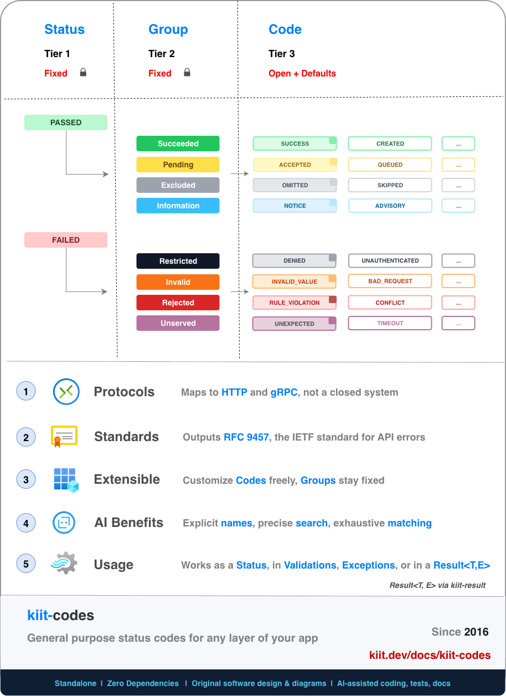

<div align="center">
<h1>
  
</h1>

**A Kotlin library to classify and handle success and failure.**

A small, dependency-free status and error taxonomy for application outcomes, with extensible codes, protocol mappings, validation, typed exceptions, and optional `Result<T, E>` integration.

[](https://central.sonatype.com/artifact/dev.kiit/kiit-codes)
[](https://github.com/kiitdev/kiit-codes/actions/workflows/ci.yml)
[](./LICENSE)
[](https://kotlinlang.org)

Part of [Kiit](https://www.kiit.dev) · [Docs](https://www.kiit.dev/docs/kiit-codes)

</div>



## 📚 Table of Contents

| # | | Topic | Description |
|---:|:---:|---|---|
| 1 | 💡 | [Why](#why) | The recurring problems Codes is designed to solve, and how it solves them |
| 2 | 🚀 | [Start](#start) | Installation, a quick example, and what built-in codes look like |
| 3 | 🗂️ | [Taxonomy](#taxonomy) | The fixed Status → Group → Code model that everything else builds on |
| 4 | 🧩 | [Extensibility](#extensibility) | Adding custom, domain-specific codes on top of the built-in taxonomy |
| 5 | 🔀 | [Protocols](#protocols) | Mapping application outcomes to HTTP, gRPC, and other transports |
| 6 | ⚙️ | [Usage](#usage) | Status handling, validation, exceptions, and Result covered in the docs |
| 7 | 🗺️ | [Roadmap](#roadmap) | Project history, current focus, and planned improvements |
| 8 | 📖 | [Learn More](#learn-more) | Deeper documentation, design rationale, and FAQ on kiit.dev |
| 9 | 📋 | [Requirements](#requirements) | Supported platforms and runtime dependencies |
| 10 | 🤝 | [Contributing](#contributing) | How to build, test, and contribute changes |
| 11 | 📄 | [License](#license) | Apache 2.0 license terms |

## Why
Applications need to communicate a simple idea consistently: **what happened?**

In practice, success and failure are often modeled differently across domains, application layers, protocols, and error-handling approaches. This creates several recurring problems:

|  # | Problem            | Description                                                             |
| -: |--------------------|-------------------------------------------------------------------------|
|  1 | **Classification** | No shared taxonomy for modeling success and failure.                    |
|  2 | **Consistency**    | Outcomes vary across application layers and protocols.                  |
|  3 | **Fragmentation**  | Validation, exceptions, statuses, and results use different approaches. |
|  4 | **Boilerplate**    | Similar error types and handling are rebuilt across projects and teams. |
|  5 | **Specificity**    | Generic errors often lack precise domain meaning.                       |

**kiit-codes provides a shared application-level model for these concerns.**

A fixed taxonomy provides consistent classification, extensible codes preserve domain-specific meaning, and protocol mappings keep application outcomes independent from their transport. The same model can then be used across statuses, validation, exceptions, and result types.

## Start

**Gradle (Kotlin DSL):**

```kotlin
dependencies {
    implementation("dev.kiit:kiit-codes:1.2.0")
}
```

This is how a code is constructed: a name, a title, an origin that says who owns it, and an optional scope inside that origin.

```kotlin
import kiit.codes.*

val MISSING_DATE = Invalid(
    name = "MISSING_DATE",
    title = "Date not supplied",
    origin = "samples.kiit.dev",
    scope = "tasks",
)
```

Codes expose stable fields suitable for application logic, logging, APIs, and diagnostics:

```json
{
    "name"    : "CONFLICT",
    "group"   : "Rejected",
    "origin"  : "kiit.dev",
    "scope"   : "codes",
    "success" : false,
    "title"   : "The request conflicts with the current state"
}
```

## Taxonomy

Codes uses a three-tier model:

| Tier   | Name       | Fixed/Open | Suggested wording                                                      |
| ------ | ---------- | ---------- | ---------------------------------------------------------------------- |
| Tier 1 | **Status** | Fixed      | Classifies an outcome as `Passed` or `Failed`.                         |
| Tier 2 | **Group**  | Fixed      | Classifies the kind of success or failure.                             |
| Tier 3 | **Code**   | Open       | Identifies a specific outcome using built-in or domain-specific codes. |

**Status → Group → Code**

`Status` and `Group` are fixed so applications share the same high-level meaning. `Code` is open: Kiit supplies common defaults while applications can add their own domain-specific codes.


The two statuses are:

- **Passed** — `Succeeded`, `Pending`, `Excluded`, `Information`
- **Failed** — `Restricted`, `Invalid`, `Rejected`, `Unserved`

Each code provides a `name`, `group`, `origin`, `title`, and `success` flag. Built-in codes use the `kiit.dev` origin and each group has a default code for cases where more precision is unnecessary.

The built-in taxonomy contains common application outcomes such as `SUCCESS`, `CREATED`, `DENIED`, `INVALID_VALUE`, `CONFLICT`, `TIMEOUT`, and `UNEXPECTED`.

## Extensibility

The taxonomy stays consistent while codes remain open to your domain.


Custom codes use the same group types as Kiit's defaults:

```kotlin
import kiit.codes.Failed

// Example custom code
val PAYMENT_DECLINED = Failed.Rejected(
    name = "PAYMENT_DECLINED",
    title = "Payment declined",
    origin = "payments"
)
```

`PAYMENT_DECLINED` remains a `Rejected` outcome everywhere in the system while retaining its domain-specific identity. The `origin` keeps custom namespaces distinct from Kiit and from other modules or teams. Use a real domain when you have one (`stripe.com`), or a specific name otherwise. kiit-codes can't detect two teams choosing the same name.

## Protocols

Application outcomes should describe **what happened**, independently of how they are transported.

Kiit codes can be mapped to protocol-specific representations at system boundaries.


### HTTP

`CodesToHttp` maps statuses to HTTP codes using group defaults plus specific overrides where needed.

```kotlin
import kiit.codes.*

val http = CodesToHttp()

http.toCode(Succeeded.CREATED) // 201
http.toCode(Invalid.INVALID_VALUE) // 400
http.toCode(Invalid.NOT_FOUND) // 404
```

There is no reverse conversion from an HTTP code to a status. Many statuses share one code, so a code can't identify a single status.

### gRPC

`CodesToGrpc` follows the same model and covers all gRPC status codes.

```kotlin
import kiit.codes.*

val grpc = CodesToGrpc()

grpc.toCode(Restricted.DENIED)   // 7, PERMISSION_DENIED
grpc.toCode(Rejected.CONFLICT)   // 6, ALREADY_EXISTS
```

### RFC 9457 (Problem Details)

`ProblemConverter` converts a status into an [RFC 9457](https://www.rfc-editor.org/rfc/rfc9457.html) problem details object, for an HTTP API response. A kiit-native equivalent, `CodeDetail`, covers boundaries an HTTP-shaped response doesn't fit, such as service-to-service calls and background jobs.

Four cases cover every `type`:

```kotlin
val duplicate = Rejected("DUPLICATE_CHARGE", "Duplicate charge", origin = "stripe.com", scope = "payments.cards")
val outOfStock = Rejected("OUT_OF_STOCK", "Out of stock", origin = "myapp1")
```

| # | Case | `type` |
|---|---|---|
| 1 | Built-in | `https://www.kiit.dev/docs/kiit-codes?code=Failed:Invalid:INVALID_VALUE#codes` |
| 2 | Custom, no base URL, domain origin | `https://stripe.com/docs/codes/payments/cards/Failed/Rejected/DUPLICATE_CHARGE` |
| 3 | Custom, no base URL, plain id | `/docs/codes/Failed/Rejected/OUT_OF_STOCK` (relative) |
| 4 | Custom, with a base URL | `https://stripe.com/errors/payments/cards/Failed/Rejected/DUPLICATE_CHARGE` |

The rules behind them:

1. **Tail:** `{scope}/{status}/{group}/{name}`, in exact case. `status` is `Passed` or `Failed`, and each `.` in a scope starts a new segment. The last three segments are the same values as `Status.code`, with `/` in place of `:`.
2. **Base:** a `baseUrls` entry for the origin, which is always absolute. With no entry, a domain origin gives `https://{origin}/docs/codes`, and any other id, such as `myapp1`, gives the relative `/docs/codes`. RFC 9457 prefers absolute URIs, and a relative `type` resolves against the response's own host, so register a base URL for a plain id.
3. **Origin:** it is not in the tail, since the base already belongs to one origin.
4. **Built-ins:** the origin `kiit.dev` links to the Codes section of these docs, as `?code=Failed:Invalid:INVALID_VALUE#codes`, and a `baseUrls` entry for `kiit.dev` is ignored. The origin is reserved for kiit-authored codes, so a custom status must not use it.
5. **Names:** an origin, a scope and a name can only contain letters, digits, `.`, `-` and `_`, and start with a letter or digit. A bad value throws when the status is created, and `StatusRules.check` tests one without throwing.

```json
{
    "type": "https://example.com/problems/Failed/Rejected/PAYMENT_DECLINED",
    "title": "Payment declined",
    "status": 409,
    "code": "payments::Failed:Rejected:PAYMENT_DECLINED"
}
```

That is `ProblemConverter(baseUrls = mapOf("payments" to "https://example.com/problems")).convert(PAYMENT_DECLINED)`.

`type` is the problem's identity as well as its docs pointer, so pick the base once and keep it, and do not let two statuses produce the same `type`. `code` is the exact `{origin}:{scope}:{Status.code}`, the same string as `CodeDetail.code`, and an empty scope stays an empty slot. Read it for the origin, the scope and the status. The tail of `type` is a readable form of the same values and is not meant to be parsed. Every error in the `Err` goes into `errors`: a list is expanded, and a single `Err.on("email", "Missing")` is one entry that keeps its field.

RFC 9457 sets no structure for `type` beyond being a URI reference, so the exact-case tail is compliant. `code` and `errors` are extension members, which clients ignore if they don't know them.

| Member | `Problem` | `CodeDetail` |
|---|---|---|
| `code` | `{origin}:{scope}:{Status.code}` | the same string |
| `title`, `detail`, `instance`, `errors` | same | same |
| `status` | the HTTP status, always set | optional |
| `type` | identity and docs link | none |
| `success` | none | `true` or `false` |

To set your own `type`, no new API is needed. Pass a `typeBuilder` to `convert`, call `convertWithUrl` with a base and an empty suffix, or replace the field with `copy(type = ...)`. `code` is built from the status, so it does not change.

The mapping abstraction is not limited to HTTP and gRPC. `CodeLookup` and `CompositeLookup` can be used to define or extend mappings for other protocols.

```kotlin
val lookup = CompositeLookup(
    base = CodesToHttp(),
    extensions = mapOf(PAYMENT_DECLINED to 402)
)

lookup.toCode(PAYMENT_DECLINED) // 402
```

## Usage

Codes is designed to work at different application boundaries without requiring one error-handling style.

### Status

Use `Status` when the outcome itself is enough.

```kotlin
import kiit.codes.*

fun authorize(userId: String, requesterId: String): Status =
    if (userId != requesterId) Restricted.UNAUTHORIZED
    else Succeeded.SUCCESS

when (val status = authorize(userId, requesterId)) {
    is Passed -> log.info("ok: ${status.name}")
    is Failed -> log.warn("failed: ${status.name} — ${status.title}")
}
```


## Roadmap

kiit-codes has been extracted from the Kiit toolkit and polished as a standalone module.
This has been used in production for over 4+ years to power mobile and server kotlin applications.
Current work is focused on the Kotlin release, documentation, examples, and ecosystem integration.

| # | Topic | Description |
|---:|---|---|
| 1 | **Documentation** | Update documentation and examples as needed. |
| 2 | **Taxonomy** | Continue taxonomy review based on real-world usage and community feedback. |

See [GitHub Issues](https://github.com/kiitdev/kiit-codes/issues) for current work and discussions.

## Learn More

| # | Topic | Description |
|---:|---|---|
| 1 | **Taxonomy** | Explore every built-in group and code, their intended meanings, defaults, and distinctions. [Read the taxonomy docs](https://www.kiit.dev/docs/kiit-codes#taxonomy). |
| 2 | **Extensibility** | Learn how extensibility works and how to create domain-specific codes while keeping the shared taxonomy intact. [Read the extensibility docs](https://www.kiit.dev/docs/kiit-codes#philosophy). |
| 3 | **Protocols** | See the complete HTTP and gRPC mappings and learn how to create custom mappings. [Read the protocol docs](https://www.kiit.dev/docs/kiit-codes#responses). |
| 4 | **Validation** | Learn how `Err`, `Checked`, and `collect` model validation and accumulate multiple errors. [Read the validation docs](https://www.kiit.dev/docs/kiit-codes#errors). |
| 5 | **Exceptions** | See the typed exception hierarchy and patterns for integrating Codes with exception-based boundaries. [Read the exception docs](https://www.kiit.dev/docs/kiit-codes#errors). |
| 6 | **Result** | Learn how the separate `kiit-result` module builds `Result<T, E>` handling on top of the same Codes taxonomy. [Read the kiit-result README](https://github.com/kiitdev/kiit-result#readme). |
| 7 | **FAQ** | Answers to common questions about the taxonomy, design choices, alternatives, adoption, AI considerations, and project maturity. [Read the FAQ](https://www.kiit.dev/docs/kiit-codes#faq). |
| 8 | **Design** | Read more about the reasoning behind fixed groups, extensible codes, protocol independence, and where Codes fits relative to domain errors. [Read the design docs](https://www.kiit.dev/docs/kiit-codes#design). |

## Requirements

- Kotlin Multiplatform
- JVM, Android, iOS (simulator, iosArm64, x64)
- No external runtime dependencies

A native TypeScript port, [`@kiitdev/codes`](https://www.npmjs.com/package/@kiitdev/codes), is
maintained separately in [`ports/kiit-codes-ts`](./ports/kiit-codes-ts) — checked against the
Kotlin taxonomy, not generated from it. See its [README](./ports/kiit-codes-ts/README.md) for
installation and usage.

## Contributing

Contributions and design feedback are welcome. See [BUILD.md](./BUILD.md) for build, test, and publish instructions.

## License

[Apache License 2.0](./LICENSE)

---

<div align="center">

**kiit-codes** is one module of [Kiit](https://www.kiit.dev) — a lightweight, modular Kotlin toolkit for building server applications, APIs, CLIs, and jobs.

**Adopt one module at a time.**

</div>
