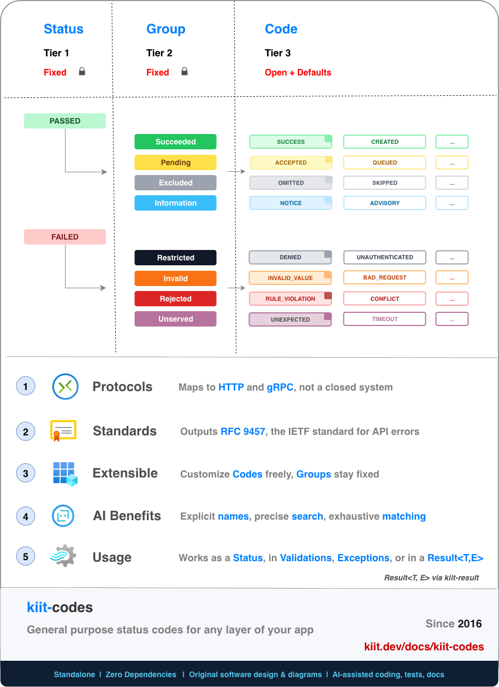

<div align="center">
<h1>
  
</h1>

**General purpose status codes, for any layer of your app, to classify success and failure.**

A small, dependency-free status and error taxonomy for application outcomes, with extensible codes, HTTP mapping, validation, typed errors, and RFC 9457 support.

Part of [Kiit](https://www.kiit.dev) · [Docs](https://www.kiit.dev/docs/kiit-codes)

</div>

This is the native TypeScript port of [kiit-codes](https://github.com/kiitdev/kiit-codes). Kotlin is the canonical implementation. This package is a port checked against it, not an independent implementation that happens to agree today — see [`kiit-codes`](https://github.com/kiitdev/kiit-codes/tree/main/kiit-codes).



## 📚 Table of Contents

| # | | Topic | Description |
|---:|:---:|---|---|
| 1 | 💡 | [Why](#why) | The recurring problems Codes is designed to solve, and how it solves them |
| 2 | 🚀 | [Start](#start) | Installation, a quick example, and what built-in codes look like |
| 3 | 🗂️ | [Taxonomy](#taxonomy) | The fixed Status → Group → Code model that everything else builds on |
| 4 | 🧩 | [Extensibility](#extensibility) | Adding custom, domain-specific codes on top of the built-in taxonomy |
| 5 | 🔀 | [Protocols](#protocols) | Mapping application outcomes to HTTP and other transports |
| 6 | ⚙️ | [Usage](#usage) | Status handling and exhaustive narrowing; validation, errors, and Result covered in the docs |
| 7 | 🗺️ | [Roadmap](#roadmap) | Project history, current focus, and planned improvements |
| 8 | 📖 | [Learn More](#learn-more) | Deeper documentation, design rationale, and FAQ on kiit.dev |
| 9 | 📋 | [Requirements](#requirements) | Supported runtimes and module systems |
| 10 | 🤝 | [Contributing](#contributing) | How to build, test, and contribute changes |
| 11 | 📄 | [License](#license) | Apache 2.0 license terms |

## Why
Applications need to communicate a simple idea consistently: **what happened?**

In practice, success and failure are often modeled differently across domains, application layers, protocols, and error-handling approaches. This creates several recurring problems:

|  # | Problem            | Description                                                             |
| -: |--------------------|-------------------------------------------------------------------------|
|  1 | **Classification** | No shared taxonomy for modeling success and failure.                    |
|  2 | **Consistency**    | Outcomes vary across application layers and protocols.                  |
|  3 | **Fragmentation**  | Validation, exceptions, statuses, and results use different approaches. |
|  4 | **Boilerplate**    | Similar error types and handling are rebuilt across projects and teams. |
|  5 | **Specificity**    | Generic errors often lack precise domain meaning.                       |

**@kiitdev/codes provides a shared application-level model for these concerns.**

A fixed taxonomy provides consistent classification, extensible codes preserve domain-specific meaning, and protocol mappings keep application outcomes independent from their transport. The same model can then be used across statuses, validation, errors, and result types.

## Start

```bash
npm install @kiitdev/codes
```

A code is a name, a title, an origin that says who owns it, and an optional scope inside that origin.

```ts
import { Invalid } from "@kiitdev/codes";

const MISSING_DATE = Invalid("MISSING_DATE", "Date not supplied", "samples.kiit.dev", "tasks");
```

Codes expose stable fields suitable for application logic, logging, APIs, and diagnostics:

```json
{
    "group"   : "Rejected",
    "success" : false,
    "name"    : "CONFLICT",
    "title"   : "The request conflicts with the current state.",
    "origin"  : "kiit.dev",
    "scope"   : "codes"
}
```

`CodesToHttp` maps a status to an HTTP code, using group defaults plus specific overrides.

```ts
import { Succeeded, Invalid, CodesToHttp } from "@kiitdev/codes";

const http = CodesToHttp();

http.toCode(Succeeded.CREATED); // 201
http.toCode(Invalid.INVALID_VALUE); // 400
http.toCode(Invalid.NOT_FOUND); // 404
```

Every group is a plain object, not a class. Construct one without `new` (`Restricted.UNAUTHORIZED`, or `Restricted("CUSTOM_CODE", "Title of the code")` for a domain-specific one), and a value survives `JSON.parse` unchanged, since nothing about it depends on how it was constructed.

## Taxonomy

Codes uses a three-tier model:

| Tier   | Name       | Fixed/Open | Suggested wording                                                      |
| ------ | ---------- | ---------- | ---------------------------------------------------------------------- |
| Tier 1 | **Status** | Fixed      | Classifies an outcome as `Passed` or `Failed`.                         |
| Tier 2 | **Group**  | Fixed      | Classifies the kind of success or failure.                             |
| Tier 3 | **Code**   | Open       | Identifies a specific outcome using built-in or domain-specific codes. |

**Status → Group → Code**

`Status` and `Group` are fixed so applications share the same high-level meaning. `Code` is open: Kiit supplies common defaults while applications can add their own domain-specific codes.


The two statuses are:

- **Passed**: `Succeeded`, `Pending`, `Excluded`, `Information`
- **Failed**: `Restricted`, `Invalid`, `Rejected`, `Unserved`

Each code provides a `name`, `group`, `origin`, `title`, and `success` flag. Built-in codes use the `kiit.dev` origin and each group has a default code for cases where more precision is unnecessary.

The built-in taxonomy contains common application outcomes such as `SUCCESS`, `CREATED`, `DENIED`, `INVALID_VALUE`, `CONFLICT`, `TIMEOUT`, and `UNEXPECTED`.

## Extensibility

The taxonomy stays consistent while codes remain open to your domain.


Custom codes use the same group constructors as Kiit's defaults:

```ts
import { Rejected } from "@kiitdev/codes";

// Example custom code
const PAYMENT_DECLINED = Rejected("PAYMENT_DECLINED", "Payment declined", "payments");
```

`PAYMENT_DECLINED` remains a `Rejected` outcome everywhere in the system while retaining its domain-specific identity. The `origin` keeps custom namespaces distinct from Kiit and from other modules or teams. Use a real domain when you have one (`stripe.com`), or a specific name otherwise. @kiitdev/codes can't detect two teams choosing the same name.

## Protocols

Application outcomes should describe **what happened**, independently of how they are transported.

Kiit codes can be mapped to protocol-specific representations at system boundaries.


### HTTP

`CodesToHttp` maps statuses to HTTP codes using group defaults plus specific overrides where needed.

```ts
import { Succeeded, Invalid, CodesToHttp } from "@kiitdev/codes";

const http = CodesToHttp();

http.toCode(Succeeded.CREATED); // 201
http.toCode(Invalid.INVALID_VALUE); // 400
http.toCode(Invalid.NOT_FOUND); // 404
```

There is no reverse conversion from an HTTP code to a status. Many statuses share one code, so a code can't identify a single status.

### gRPC

The Kotlin library has `CodesToGrpc`. The TypeScript port does not have a gRPC mapping yet. To map to gRPC today, write a `CodeLookup` (see [Custom mappings](#custom-mappings)) that returns the gRPC code you need.

### RFC 9457 (Problem Details)

`ProblemConverter` turns a status and an optional `Err` into an [RFC 9457](https://www.rfc-editor.org/rfc/rfc9457.html) problem for an HTTP response. `toCodeDetail` is the kiit-native shape for service-to-service calls.

```ts
import { ProblemConverter, Rejected, Err } from "@kiitdev/codes";

const status = Rejected("DUPLICATE_CHARGE", "This charge has already been processed", "stripe.com", "payments.cards");
const problem = ProblemConverter().convert(status, Err.onField("amount", "Too low"));
// {
//   type: "https://stripe.com/docs/codes/payments/cards/Failed/Rejected/DUPLICATE_CHARGE",
//   title: "This charge has already been processed",
//   status: 409,
//   detail: "Too low",
//   errors: [{ field: "amount", message: "Too low" }],
//   code: "stripe.com:payments.cards:Failed:Rejected:DUPLICATE_CHARGE"
// }
```

Four cases cover every `type`:

```ts
import { Rejected } from "@kiitdev/codes";

const duplicate = Rejected("DUPLICATE_CHARGE", "Duplicate charge", "stripe.com", "payments.cards");
const outOfStock = Rejected("OUT_OF_STOCK", "Out of stock", "myapp1");
```

| # | Case | `type` |
|---|---|---|
| 1 | Built-in | `https://www.kiit.dev/docs/kiit-codes?code=Failed:Invalid:INVALID_VALUE#codes` |
| 2 | Custom, no base URL, domain origin | `https://stripe.com/docs/codes/payments/cards/Failed/Rejected/DUPLICATE_CHARGE` |
| 3 | Custom, no base URL, plain id | `/docs/codes/Failed/Rejected/OUT_OF_STOCK` (relative) |
| 4 | Custom, with a base URL | `https://stripe.com/errors/payments/cards/Failed/Rejected/DUPLICATE_CHARGE` |

1. **type:** `{base}/{scope}/{status}/{group}/{name}`, in exact case. `status` is `Passed` or `Failed`, and each `.` in a scope starts a new segment. The last three segments are the same values as `statusCode(status)`, with `/` in place of `:`. The origin is not in the tail.
2. **Base:** a `baseUrls` entry for the origin, which is always absolute. With no entry, a domain origin gives `https://{origin}/docs/codes`, and any other id, such as `"myapp1"`, gives the relative `/docs/codes`, so register a base URL for a plain id.
3. **Built-ins:** the origin `kiit.dev` links to the Codes section of the kiit-codes docs, as `?code=Failed:Invalid:INVALID_VALUE#codes`, and an entry for `kiit.dev` is ignored. The origin is reserved for kiit-authored codes, so a custom status must not use it.
4. **Names:** an origin, a scope and a name can only contain letters, digits, `.`, `-` and `_`, and start with a letter or digit. A bad value throws when the status is created, and `StatusRules.check` tests one without throwing.
5. **Identity:** `type` is the problem's identity as well as its docs pointer, so pick the base once and keep it. `code` is the exact `{origin}:{scope}:{status code}`, the same string as `CodeDetail.code`. Read it for the origin, the scope and the status. The tail of `type` is not meant to be parsed.
6. **errors:** every error in the `Err` goes into `errors`. A list is expanded, and a single `Err.onField(...)` is one entry that keeps its field.
7. **Your own type URL:** pass a `typeBuilder` to `convert`, call `convertWithUrl` with a base and an empty suffix, or spread the problem with your own `type`: `{ ...problem, type: "https://..." }`. `code` does not change.

### Custom mappings

The mapping abstraction is not limited to HTTP. `CodeLookup` is a plain interface with one method, `toCode(status)`, so a mapping for another protocol, or an extension of `CodesToHttp`, is an object.

```ts
import { CodesToHttp, Rejected } from "@kiitdev/codes";
import type { CodeLookup } from "@kiitdev/codes";

const PAYMENT_DECLINED = Rejected("PAYMENT_DECLINED", "Payment declined", "payments");

// Your value first, the base mapping for everything else
const base = CodesToHttp();
const lookup: CodeLookup = {
  toCode: (status) =>
    status.origin === PAYMENT_DECLINED.origin && status.name === PAYMENT_DECLINED.name
      ? 402
      : base.toCode(status),
};

lookup.toCode(PAYMENT_DECLINED); // 402
lookup.toCode(Rejected.CONFLICT); // 409
```

The Kotlin library has a `CompositeLookup` for this. The TypeScript port does not have one yet.

## Usage

Codes is designed to work at different application boundaries without requiring one error-handling style.

### Status

Use `Status` when the outcome itself is enough.

```ts
import { Succeeded, Restricted } from "@kiitdev/codes";
import type { Status } from "@kiitdev/codes";

function authorize(userId: string, requesterId: string): Status {
  return userId !== requesterId ? Restricted.UNAUTHORIZED : Succeeded.SUCCESS;
}

const status = authorize("u1", "u2");
if (status.success) {
  console.log(`ok: ${status.name}`);
} else {
  console.warn(`failed: ${status.name} — ${status.title}`);
}
```


### Exhaustive narrowing

```ts
import { Groups, assertNever } from "@kiitdev/codes";
import type { Status } from "@kiitdev/codes";

function describe(status: Status): string {
  switch (status.group) {
    case Groups.SUCCEEDED: return "ok";
    case Groups.PENDING: return "waiting";
    case Groups.EXCLUDED: return "excluded";
    case Groups.INFORMATION: return "info";
    case Groups.RESTRICTED: return "restricted";
    case Groups.INVALID: return "invalid";
    case Groups.REJECTED: return "rejected";
    case Groups.UNSERVED: return "unserved";
    default: return assertNever(status); // dropping a case here is a compile error
  }
}
```

## Roadmap

The taxonomy has been used in production for over 4 years to power mobile and server Kotlin applications. This package is its native TypeScript port, first released as 1.0.0.
Current work is focused on the TypeScript release, documentation, examples, and ecosystem integration.

| # | Topic | Description |
|---:|---|---|
| 1 | **Documentation** | Update documentation and examples as needed. |
| 2 | **Taxonomy** | Continue taxonomy review based on real-world usage and community feedback. |

See [GitHub Issues](https://github.com/kiitdev/kiit-codes/issues) for current work and discussions.

## Learn More

The documentation site is written around the Kotlin library. The taxonomy is the same in both, and the TypeScript API differs where this README says so.

| # | Topic | Description |
|---:|---|---|
| 1 | **Taxonomy** | Explore every built-in group and code, their intended meanings, defaults, and distinctions. [Read the taxonomy docs](https://www.kiit.dev/docs/kiit-codes#taxonomy). |
| 2 | **Extensibility** | Learn how extensibility works and how to create domain-specific codes while keeping the shared taxonomy intact. [Read the extensibility docs](https://www.kiit.dev/docs/kiit-codes#philosophy). |
| 3 | **Protocols** | See the complete HTTP mapping and learn how to create custom mappings. [Read the protocol docs](https://www.kiit.dev/docs/kiit-codes#responses). |
| 4 | **Validation** | Learn how `Err`, `Checked`, and `collect` model validation and accumulate multiple errors. [Read the validation docs](https://www.kiit.dev/docs/kiit-codes#errors). |
| 5 | **Exceptions** | See the typed error hierarchy and patterns for integrating Codes with exception-based boundaries. [Read the exception docs](https://www.kiit.dev/docs/kiit-codes#errors). |
| 6 | **Result** | Learn how the separate `kiit-result` module builds `Result<T, E>` handling on top of the same Codes taxonomy. [Read the kiit-result README](https://github.com/kiitdev/kiit-result#readme), or get the TypeScript port, [`@kiitdev/result`](https://www.npmjs.com/package/@kiitdev/result). |
| 7 | **FAQ** | Answers to common questions about the taxonomy, design choices, alternatives, adoption, AI considerations, and project maturity. [Read the FAQ](https://www.kiit.dev/docs/kiit-codes#faq). |
| 8 | **Design** | Read more about the reasoning behind fixed groups, extensible codes, protocol independence, and where Codes fits relative to domain errors. [Read the design docs](https://www.kiit.dev/docs/kiit-codes#design). |

Kotlin source: [kiitdev/kiit-codes](https://github.com/kiitdev/kiit-codes), the canonical implementation.

## Requirements

Node 22.13 or later. The package is ESM-first with one build, and it works from both module systems:

```ts
import { Succeeded } from "@kiitdev/codes";
```

```js
const { Succeeded } = require("@kiitdev/codes");
```

`require()` loads the ES module directly, which Node supports without a flag or warning from 22.13. A project on Jest's default CommonJS setup may need `transformIgnorePatterns` changed to let Jest handle the package. Browser, Deno and Bun are not covered by this range.

No external runtime dependencies.

## Contributing

Contributions and design feedback are welcome. See [BUILD.md](https://github.com/kiitdev/kiit-codes/blob/main/BUILD.md) for build, test, and publish instructions.

## License

[Apache License 2.0](./LICENSE)
